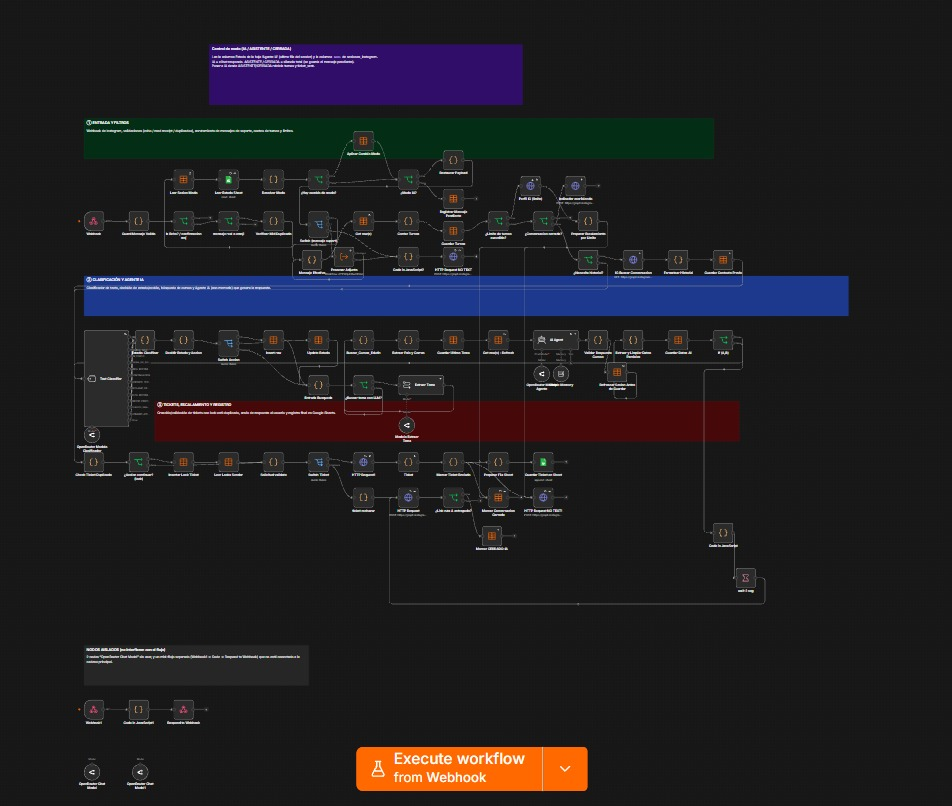
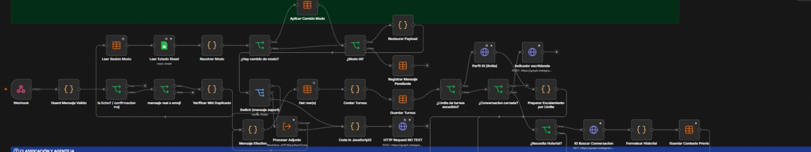
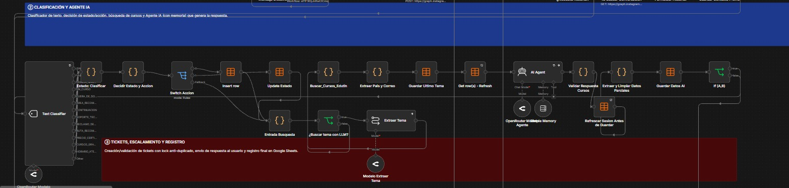
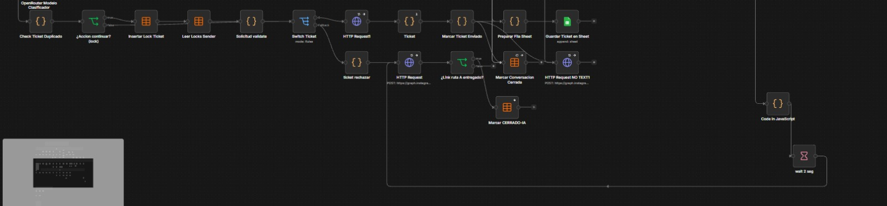
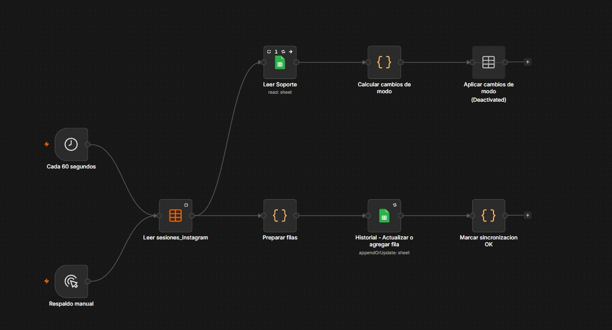
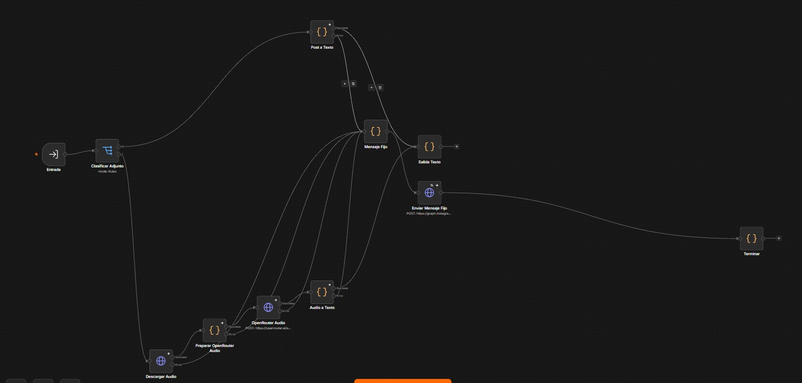
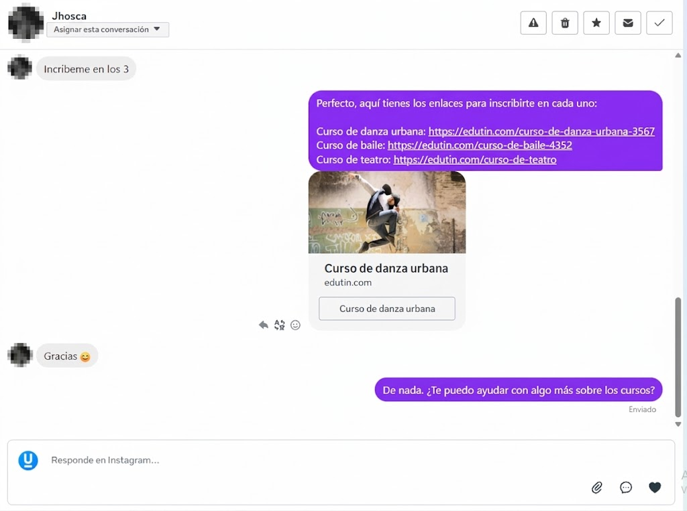

# Instagram AI Chatbot — n8n

Chatbot de atención y ventas para mensajes directos de Instagram, construido en n8n y en producción con tráfico real. Clasifica cada mensaje, responde con un agente de IA que tiene memoria de la conversación, busca cursos en un catálogo vía API y escala a una asesora humana con un ticket cuando hace falta.

## Arquitectura

| Carril | Qué hace |
|---|---|
| ① Entrada y filtros | Webhook de Meta, descarte de *echo* / *read receipts*, deduplicación por `message.mid`, conteo de turnos y límites |
| ② Clasificación y agente IA | Clasificador de texto, decisión de estado/acción, búsqueda de cursos y agente LLM (OpenRouter) con memoria |
| ③ Tickets y escalamiento | Creación de tickets con *lock* anti-duplicado, envío de la respuesta y registro en Google Sheets |
| ⓪ Control de modo | Cambio IA / ASISTENTE / CERRADA desde la hoja de soporte: cuando una persona toma el chat, el bot se silencia |

**Stack:** n8n (83 nodos: Code JS, Data Tables, Switch/IF, LangChain Agent), Instagram Graph API, OpenRouter, Google Sheets.

### Vista general del workflow

### ① Entrada y filtros

Webhook, validación del mensaje, descarte de *echo* y confirmaciones de lectura, deduplicación por `mid`, resolución del modo (IA / ASISTENTE / CERRADA) y control de turnos.

### ② Clasificación y agente IA

El *Text Classifier* etiqueta la intención (búsqueda de cursos, precio/certificado, soporte técnico, reclamo, ruta recomendada, etc.), se decide la acción, se buscan cursos en el catálogo y el *AI Agent* (OpenRouter + memoria) redacta la respuesta.

### ③ Tickets, escalamiento y registro

Verificación de ticket duplicado con *lock*, creación del ticket, envío de la respuesta por la Graph API y registro en Google Sheets.

### Workflows auxiliares

**Sincronización de sesiones y modo** — cada 5 minutos lee la tabla  `sesiones_instagram`, actualiza el historial en Google Sheets y aplica los cambios de modo que el equipo de soporte marca en la hoja.

**Procesar adjuntos** — sub-workflow que clasifica el adjunto: convierte publicaciones compartidas a texto y transcribe audios con OpenRouter; para otros tipos responde con un mensaje fijo.

## Ejemplo de conversación real

Una persona pide inscribirse en tres cursos; el bot responde con los enlaces de cada uno y cierra ofreciendo más ayuda:

  

## Configuración

Por seguridad, este repositorio **no contiene credenciales ni IDs reales**. Para importarlo:

1. En n8n, ve a **Workflows → Import from file** y elige `workflows/instagram-chatbot.json`.
2. Crea estas credenciales y asígnalas a los nodos que lo piden:
   - **Instagram Graph API (access_token)**: tipo *Query Auth*, nombre `access_token`, valor = tu token de Instagram.
   - **OpenRouter account**: tu API key de OpenRouter.
   - **Google Sheets account**: OAuth2 de Google.
3. Reemplaza estos placeholders:

| Placeholder | Dónde |
|---|---|
| `YOUR_N8N_API_KEY` | Nodo *Verificar Mid Duplicado* (lo ideal es leerlo de una variable de entorno) |
| `YOUR_DATATABLE_ID_*` | Nodos Data Table (`sesiones_instagram`, `ticket_locks`, `mensajes_procesados`) |
| `YOUR_GOOGLE_SHEET_ID` | Nodos *Guardar Ticket en Sheet* y *Leer Estado Sheet* |
| `YOUR_FACEBOOK_PAGE_ID` | Nodo *Ticket* (link a la bandeja de Meta Business) |
| `YOUR_SUBWORKFLOW_ID_procesar_adjuntos` | Nodo *Procesar Adjunto* (sub-workflow, no incluido) |

4. Configura la URL del webhook en tu app de Meta (ruta `instagram-webhook`).
